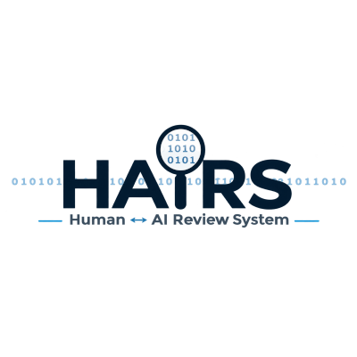

<p align="center">
  <picture>
    <source media="(prefers-color-scheme: dark)" srcset="assets/hairs.png">
    <source media="(prefers-color-scheme: light)" srcset="assets/hairs.png">
    
  </picture>
</p>

<p align="center">
  <strong>Autonomous Code Assurance &bull; Roslyn AST Structural Fingerprinting &bull; Deterministic CI/CD Verification Gates</strong>
</p>

<p align="center">
  <a href="https://github.com/H-AI-RS/hairs"></a>
  <a href="https://dotnet.microsoft.com/"></a>
  <a href="https://learn.microsoft.com/dotnet/csharp/"></a>
  <a href="https://www.nuget.org/packages/Hairs"></a>
  <a href="https://www.nuget.org/packages/Hairs.Cli"></a>
  <a href="https://opensource.org/licenses/Apache-2.0"></a>
</p>

---

## Welcome to the HAIRS Organization (`.github`)

This repository serves as the organization profile, community health configuration, and public landing page for the **HAIRS (Human AI Review System)** ecosystem.

- **Primary Repository:** [**github.com/H-AI-RS/hairs**](https://github.com/H-AI-RS/hairs)
- **Organization Profile README:** [`profile/README.md`](profile/README.md)
- **Interactive Web Showcase:** [`index.html`](index.html)

---

## The Core Invariant

> **"Automation may assess, measure, calculate fingerprints, and invalidate stale records; automation may NEVER invent or forge a human decision."**

---

## Overview

**HAIRS (Human AI Review System)** is an autonomous, standalone code review and code assurance engineering framework. It provides a formal, machine-checked system for auditing codebases, recording human and AI attestations, tracking content freshness, and enforcing release readiness through deterministic verification gates.

As artificial intelligence accelerates code authoring, traditional review models based on fragile line numbers, manual pull request checklists, and ephemeral approvals become major release hazards. **HAIRS solves this with dual-layer, content-addressed, AST-verified assurance:**

1. **File Review Engine:** Content-addressed file freshness evaluated via normalized SHA-256 hashes (`sha256-nlf:`). If files are touched and later reverted, freshness is restored without human overhead. Syntax-anchored review notes track relocations across code changes.
2. **Declaration Code Assurance Gate:** In-source declarations (`// Hairs-AI:`, `// Hairs-Human:`, `// Hairs-Falsified-If:`) bound to 6-character hex structural AST fingerprints generated by Roslyn. Any logic alteration immediately invalidates prior human signatures and trips CI release gates.

Built with strict standards: .NET 10, C# 13, `TreatWarningsAsErrors=true`, Central Package Management (CPM), and **zero coupling** to host editors or proprietary UI harnesses.

---

## Quick Installation & CLI Usage

### Install Standalone CLI Tool

```powershell
dotnet tool install -g Hairs.Cli
```

### Install Shared Core Library

```powershell
dotnet add package Hairs
```

### Quick Commands

```powershell
# File Review Coverage
hairs coverage --root . --markdown coverage.md --json coverage.json

# Check file freshness against changed files
hairs check --root . --changed changed-files.txt --fail-on-stale

# Code Assurance Status
hairs assurance status --root .

# Discover Unannotated Units
hairs assurance list --root . --json units.json

# Insert Initial Machine Assessments
hairs assurance insert --root . --assessments units.json

# Generate Headers, Manifest & Roslyn Fingerprints
hairs assurance generate --root .

# Verification & CI Release Gate
hairs assurance check --root . --release
```

---

## In-Source Assurance Syntax

```csharp
// HAIRS Code Assurance
// --------------------
// Origin=AI; IP=Low; Security=High; Resources=2; Fingerprint=4A3BFD
// Hairs-Falsified-If: an unauthorized tenant can access cross-partition telemetry
// Hairs-Human:        EB; Fingerprint=4A3BFD
public async Task<TelemetryBatch> DispatchTelemetryAsync(PartitionKey key, TelemetryPayload payload)
{
    // ...
}
```

---

## Assurance State Machine

```
   [ NEW ] ──> [ AI_ASSESSED ] ──> [ HUMAN_PENDING ] ──> [ HUMAN_APPROVED ] ──> [ VERIFIED ]
                                                                                   │
                                                      Code logic modified ─────────┘
                                                                                   │
                                                                                   v
                                                                               [ STALE ]
```

---

## Repositories & Resources

- [**`H-AI-RS/hairs` Source Code**](https://github.com/H-AI-RS/hairs): Complete .NET 10 solution, CLI, Roslyn scanner, and 375 tests.
- [**Concepts and Trust Model**](https://github.com/H-AI-RS/hairs/blob/main/concepts.md): Three review layers, evidence types, state machines, and scoring rubric.
- [**Workflow and CI Integration**](https://github.com/H-AI-RS/hairs/blob/main/workflow.md): Step-by-step assessment, human signing, and CI release gates.
- [**Implementation Map**](https://github.com/H-AI-RS/hairs/blob/main/implementation.md): Complete mapping of types, modules, and architecture in `Hairs`.
- [**Findings & Architectural Decisions**](https://github.com/H-AI-RS/hairs/blob/main/findings.md): Resolved differences, clean boundaries, and safety guarantees.

---

## License

Licensed under the [Apache License 2.0](https://github.com/H-AI-RS/hairs/blob/main/LICENSE).  
Copyright &copy; 2026 HAIRS contributors.
