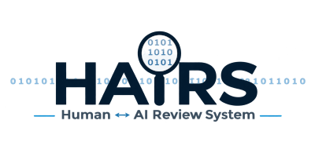

<p align="center">
  <picture>
    <source media="(prefers-color-scheme: dark)" srcset="assets/hairs.png">
    <source media="(prefers-color-scheme: light)" srcset="assets/hairs.png">
    
  </picture>
</p>

<p align="center">
  <strong>Autonomous Code Assurance &bull; Roslyn AST Structural Fingerprinting &bull; Deterministic CI/CD Verification Gates</strong>
</p>

<p align="center">
  <a href="https://github.com/H-AI-RS/hairs"></a>
  <a href="https://dotnet.microsoft.com/"></a>
  <a href="https://learn.microsoft.com/dotnet/csharp/"></a>
  <a href="https://www.nuget.org/packages/Hairs"></a>
  <a href="https://www.nuget.org/packages/Hairs.Cli"></a>
  <a href="#test-suite--verification"></a>
  <a href="https://opensource.org/licenses/Apache-2.0"></a>
</p>

---

## The Core Invariant

> **"Automation may assess, measure, calculate fingerprints, and invalidate stale records; automation may NEVER invent or forge a human decision."**

---

## Why HAIRS?

Modern software development increasingly relies on automation, AI-assisted coding, and contributions from distributed teams.

At the same time, incidents such as the xz Utils backdoor (2024), the event-stream compromise (2018), and the SolarWinds supply-chain attack (2020) have demonstrated how difficult it can be to maintain trust across source code, dependencies, build processes, and software releases.

These incidents were not caused by AI-generated code. However, they highlight broader challenges involving code provenance, review accountability, and release integrity.

HAIRS (Human–AI Review System) is designed to address these challenges through traceable, source-bound human reviews, risk classification, and automated release validation.

Its goal is not to guarantee that software is free of vulnerabilities, but to make review coverage measurable, changes traceable, and release decisions accountable.

> **AI can accelerate development. Human accountability must remain verifiable.**

---

## Overview

**HAIRS (Human AI Review System)** is an autonomous, standalone code review and code assurance engineering framework. It provides a formal, machine-checked system for auditing codebases, recording human and AI attestations, tracking content freshness, and enforcing release readiness through deterministic verification gates.

As artificial intelligence accelerates code authoring, traditional review models based on fragile line numbers, manual pull request checklists, and ephemeral approvals become major release hazards. **HAIRS solves this with dual-layer, content-addressed, AST-verified assurance:**

1. **File Review Engine:** Content-addressed file freshness evaluated via normalized SHA-256 hashes (`sha256-nlf:`). If files are touched and later reverted, freshness is restored without human overhead. Syntax-anchored review notes track relocations across code changes.
2. **Declaration Code Assurance Gate:** In-source declarations (`// Hairs-AI:`, `// Hairs-Human:`, `// Hairs-Falsified-If:`) bound to 6-character hex structural AST fingerprints generated by Roslyn. Any logic alteration immediately invalidates prior human signatures and trips CI release gates.

Built with strict standards: .NET 10, C# 13, `TreatWarningsAsErrors=true`, Central Package Management (CPM), and **zero coupling** to host editors or proprietary UI harnesses.

---

## Key Highlights

```
┌────────────────────────────────────────────────────────────────────────┐
│                        HAIRS ASSURANCE STACK                          │
├────────────────────────────────────────────────────────────────────────┤
│  Layer 1: Component Attestation   │ HUMAN_REVIEW.md (Release Scope)    │
│  Layer 2: File Review Engine      │ sha256-nlf: & Anchored Notes       │
│  Layer 3: Supply Chain Integrity  │ Workflows, CPM, Scripts & Configs  │
│  Layer 4: Declaration Assurance   │ Roslyn AST Fingerprints + Gates   │
└────────────────────────────────────────────────────────────────────────┘
```

- **Supply Chain Integrity:** Content-addressed audit over CI/CD workflows, build automation, Central Package Management (CPM) dependencies, and tool configurations.
- **Dual-Layer Assurance:** Audit an entire repository file-by-file and declare granular, method-level security and provenance criteria directly in code.
- **Roslyn AST Semantic Fingerprints:** Computes a deterministic 6-character hex hash over AST tokens. Whitespace formatting changes do not invalidate reviews; any semantic or logic change immediately triggers the `STALE` state.
- **Popperian Falsification Criteria:** High- and Critical-risk units mandate a `// Hairs-Falsified-If:` sentence defining observable conditions under which the implementation must be considered invalid.
- **Zero Host Coupling:** Standalone solution (`Hairs.slnx`), shared core library (`Hairs`), CLI tool (`Hairs.Cli`), and unit test suite (`Hairs.Tests`).
- **Blazing Fast Test Suite:** 392 tests in xUnit v3 In-Process Runner executing in **~1 second** with 100% pass rate.
- **CI/CD Enforcement:** Deterministic exit codes and GitHub Actions annotations (`::error::`, `::warning::`) enforcing rules J1 through J11.

---

## Supply Chain Integrity Review

Software supply chain integrity extends verification beyond application source code into the automation, build recipes, and dependencies that produce software releases.

HAIRS audits four distinct supply chain asset categories:

| Category | Monitored Assets | Protection Target |
|---|---|---|
| **`BuildPipeline`** | `.github/workflows/*.yml`, `pack.ps1`, `build.sh`, `Dockerfile` | Prevents unauthorized CI/CD modifications and build-script injections (*SolarWinds, xz Utils*). |
| **`PackageManifest`** | `Directory.Packages.props`, `Directory.Build.props`, `*.csproj`, `packages.lock.json` | Blocks dependency confusion, malicious version bumps, and unverified packages (*event-stream*). |
| **`Configuration`** | `hairs.config.json`, `.gitattributes`, `nuget.config` | Ensures security gates and verification rules cannot be silently relaxed or bypassed. |
| **`ThirdPartyCode`** | Vendored code (`vendor/*`, `third_party/*`), `Origin=ThirdParty` | Identifies and audits imported or ported external code with explicit human sign-off. |

### Supply Chain Audit Commands

```powershell
# Run supply chain integrity audit (Markdown & JSON output)
hairs supply-chain --root . --markdown supply-chain.md --json supply-chain.json

# Enforce strict supply chain verification gate in CI
hairs supply-chain --root . --fail-on-stale --minimum 100
```

---

## Dual-Layer Assurance Mechanics

### Layer 1: Content-Addressed File Reviews

File reviews record human approvals over entire source files under `.hairs-review/<path>.review.json`:

- **Normalized SHA-256 (`sha256-nlf:`):**
  - Strips leading Byte Order Marks (BOM).
  - Normalizes CRLF (`\r\n`) and CR (`\r`) to standard Unix line feeds (`\n`).
  - Preserves token text, indentation, and comments verbatim.
  - Reverting code to a previously reviewed state automatically restores freshness without human intervention.
- **Syntax-Anchored Review Notes:**
  - Notes bind to unique source fragments rather than line numbers.
  - Relocation states: `Anchored` (exact offset), `Moved` (found elsewhere uniquely), `Ambiguous` (found multiple times), or `Orphaned` (code deleted or heavily altered).

### Layer 2: Declaration Assurance Gate

Declaration assurance embeds provenance, risk ratings, and human cryptographic-like AST seals directly above C# declarations:

```csharp
// HAIRS Code Assurance
// --------------------
// Origin=AI; IP=Low; Security=High; Resources=2; Fingerprint=4A3BFD
// Hairs-Falsified-If: an unauthorized tenant can access cross-partition telemetry
// Hairs-Human:        EB; Fingerprint=4A3BFD
public async Task<TelemetryBatch> DispatchTelemetryAsync(PartitionKey key, TelemetryPayload payload)
{
    // ...
}
```

#### Rubric Dimensions

| Dimension | Permitted Values | Description |
|---|---|---|
| **`Origin`** | `AI`, `Original`, `Specification`, `Derived`, `Ported`, `ThirdParty` | Code provenance and generation source. |
| **`IP`** | `None`, `Low`, `Medium`, `High`, `Unknown` | Intellectual property and licensing exposure. |
| **`Security`** | `None`, `Low`, `Medium`, `High`, `Critical` | Impact of defects. High and Critical **require** `// Hairs-Falsified-If:`. |
| **`Resources`** | Integer `0` to `10` | CPU and memory footprint under worst-case adversary load. |
| **`CS` / `CL`** | Integer `0` to `10` (Optional) | Conceptual Stability and Change Likelihood. |
| **`Spec`** | Identifier (Optional) | Architectural Decision Record link (e.g., `ADR-0042`). |
| **`Fingerprint`** | 6-char hex | Deterministic Roslyn AST hash binding human signature to code logic. |

---

## The Assurance State Machine

Every declaration in a covered component exists in exactly one state, evaluated in strict guard order:

```
               ┌───────────────────────┐
               │    NEW (Unannotated)  │ (Blocks Release)
               └───────────┬───────────┘
                           │
                 [ hairs assurance insert ]
                           │
                           v
               ┌───────────────────────┐
               │      AI_ASSESSED      │ (Fingerprint=TBF, Human=PENDING)
               └───────────┬───────────┘
                           │
                [ hairs assurance generate ]
                           │
                           v
               ┌───────────────────────┐
               │     HUMAN_PENDING     │ (Fingerprint Sealed, Human=PENDING)
               └───────────┬───────────┘
                           │
                   [ Human signs alias ]
                           │
                           v
         ┌───────────────────────────────────────────┐
         │    HUMAN_APPROVED_PENDING_FINGERPRINT     │ (Alias signed, unsealed)
         └─────────────────────┬─────────────────────┘
                               │
                    [ hairs assurance generate ]
                               │
                               v
               ┌───────────────────────┐
               │       VERIFIED        │ ◄─── READY FOR RELEASE!
               └───────────┬───────────┘
                           │
                 [ Code Logic Modified ]
                           │
                           v
               ┌───────────────────────┐
               │         STALE         │ (Blocks Release! Seal Mismatch)
               └───────────────────────┘
```

### State Evaluation Rules

| State | Condition | Blocks Release? |
|---|---|---|
| `EXEMPT` | Unit is exempt by scanner predicate or explicit declaration | **No** |
| `NEW` | Declaration carries no assurance annotation block | <kbd>BLOCKS</kbd> |
| `AI_ASSESSED` | Machine block present, fingerprint is unsealed (`TBF`) | <kbd>BLOCKS</kbd> |
| `HUMAN_PENDING` | Machine fingerprint sealed, human line is `PENDING` | <kbd>BLOCKS</kbd> |
| `HUMAN_APPROVED_PENDING_FINGERPRINT` | Human alias signed, but not yet sealed by generator | <kbd>BLOCKS</kbd> |
| `VERIFIED` | Sealed human fingerprint **exactly matches** current Roslyn AST fingerprint | **No** &check; |
| `STALE` | Sealed human fingerprint differs from current AST fingerprint | <kbd>BLOCKS</kbd> |

---

## Architectural Mapping

```
                               ┌────────────────────────────────┐
                               │           Hairs.Cli            │
                               │  (dotnet tool run hairs / exe) │
                               └───────────────┬────────────────┘
                                               │
                                               ▼
                               ┌────────────────────────────────┐
                               │             Hairs              │
                               │     (Core Shared Library)      │
                               └───────┬────────────────┬───────┘
                                       │                │
                      ┌────────────────┴──┐   ┌─────────┴────────────────┐
                      │    Hairs.Review   │   │      Hairs.Assurance     │
                      │ File Engine & NLF │   │ State Machine & Generator│
                      └────────┬──────────┘   └─────────┬────────────────┘
                               │                        │
                               └───────────────┬────────┘
                                               │
                                               ▼
                               ┌────────────────────────────────┐
                               │      Hairs.Language.CSharp     │
                               │   (Roslyn AST Syntax Scanner)  │
                               └────────────────────────────────┘
```

### Repositories & Subsystems

| Subsystem | Namespace | Description |
|---|---|---|
| **Storage Abstraction** | `Hairs.Storage` | `IHairsStorage`, `FileSystemHairsStorage`, `HairsPath`, `StorageResult`. Pure zero-host file I/O abstraction. |
| **Review Engine** | `Hairs` | `FileReview`, `ReviewStore`, `ReviewCoverage`, `ReviewContentHash` (`sha256-nlf:`), `NoteAnchoring`. |
| **Assurance Engine** | `Hairs.Assurance` | `AssuranceUnit`, `AssuranceAnnotation`, `AssuranceGenerator`, `AssuranceChecks` (Rules J1–J11), `AssuranceRules`. |
| **Roslyn Language Engine** | `Hairs.Language.CSharp` | `CSharpAssuranceScanner`, `CSharpAssuranceFileScanner`, `CSharpComponentAssuranceScanner`. |
| **Command Line Interface** | `Hairs.Cli` | Top-level dispatcher, `ReviewReport`, `ComponentSources`, `AssuranceGateCommands`. |
| **Unit Test Suite** | `Hairs.Tests` | 375 comprehensive unit tests running on xUnit v3 In-Process Runner. |

---

## Quickstart & Installation

### 1. Install CLI Tool

Install the standalone CLI tool globally:

```powershell
dotnet tool install -g Hairs.Cli
```

Or run directly from source:

```powershell
dotnet run --project src/Hairs.Cli -- <command>
```

### 2. Reference Core Library

Add the core library to your .NET project:

```powershell
dotnet add package Hairs
```

### 3. Configure Component (`hairs.config.json`)

Opt in a project or component by creating a `hairs.config.json` at its root:

```json
{
  "schema": 1,
  "component": "CoreEngine",
  "projects": [
    "src/CoreEngine/CoreEngine.csproj"
  ],
  "exclude": [
    { "glob": "**/*.g.cs", "reason": "auto-generated source" }
  ],
  "artefacts": {
    "report": "CODE-ASSURANCE.md",
    "humanReview": "HUMAN_REVIEW.md",
    "manifest": "hairs.manifest.json"
  },
  "spdx": {
    "copyright": [ "2026 Contributor Name" ],
    "license": "Apache-2.0"
  }
}
```

---

## CLI Command Cheat Sheet

### File Review & Freshness Checks

```powershell
# Compute repository review coverage (Markdown & JSON)
hairs coverage --root . --markdown coverage.md --json coverage.json

# Verify file review freshness against git modified files
hairs check --root . --changed changed-files.txt --fail-on-stale --minimum 90
```

### Code Assurance Gate Commands

```powershell
# 1. Inspect current assurance status and summary counts
hairs assurance status --root .

# 2. Discover unannotated C# declarations
hairs assurance list --root . --json unannotated.json

# 3. Insert initial AI assessments into code
hairs assurance insert --root . --assessments unannotated.json

# 4. Generate structural fingerprints, file headers, and markdown reports
hairs assurance generate --root .

# 5. Prune obsolete or below-High unreviewed rubric criteria
hairs assurance prune --root .

# 6. Run consistency checks (validates ASTs, manifests, syntax, headers)
hairs assurance check --root .

# 7. CI Release Gate (Enforces 100% VERIFIED or EXEMPT units)
hairs assurance check --root . --release
```

---

## Deterministic Verification Rules (J1 – J11)

Every run of `hairs assurance check` verifies your codebase against strict engineering rules:

| Rule | Area | Description |
|:---:|---|---|
| **J1** | **Coverage** | Relevant declarations lacking assurance blocks. |
| **J2** | **Grammar** | Syntax errors in annotation blocks or unsupported claim prose. |
| **J3** | **Fingerprints** | Units with placeholder `TBF` or mismatched AST fingerprints. |
| **J4** | **Human Decision** | Automation attempting to forge human aliases or approvals. |
| **J5** | **Headers & Banners** | Stale or modified generated file headers, banners, or reports. |
| **J6** | **Directives** | Forbidden preprocessor directives inside covered source files. |
| **J7** | **Manifest** | Discrepancies between `hairs.manifest.json` and disk files. |
| **J9** | **Claims** | Unsupported review or approval claims in criterion prose. |
| **J10** | **Criteria** | Missing `// Hairs-Falsified-If:` on High or Critical security units. |
| **J11** | **Release** | Units with pending or stale human reviews under `--release`. |

---

## CI/CD & Automated NuGet Releases

HAIRS includes automated packaging and release workflows powered by GitHub Actions:

- **Workflow File:** [`.github/workflows/hairs-nuget.yml`](https://github.com/H-AI-RS/hairs/blob/main/.github/workflows/hairs-nuget.yml)
- **Automatic Version Detection:** Queries NuGet.org via REST API to detect the current preview iteration and automatically computes `N + 1` (e.g. `0.1.0-preview.1` &rarr; `0.1.0-preview.2`).
- **Release Verification Gate:** Builds solution with `TreatWarningsAsErrors=true`, executes all 375 tests, packs `.nupkg` and `.snupkg` artifacts, and pushes to NuGet.org upon approval.
- **Local Packaging:** Use `./pack.ps1 -Preview 1` for deterministic local reproduction.

---

## Organization Repositories

| Repository | Purpose | Status |
|---|---|---|
| [**`H-AI-RS/hairs`**](https://github.com/H-AI-RS/hairs) | Core standalone .NET solution: shared library, Roslyn AST engine, CLI, and test suite. | Active / Primary |
| [**`H-AI-RS/.github`**](https://github.com/H-AI-RS/.github) | Organization profile, community health standards, and global workflow configurations. | Active |

---

## License & Credits

HAIRS is licensed under the [Apache License 2.0](https://github.com/H-AI-RS/hairs/blob/main/LICENSE).  
Copyright &copy; 2026 HAIRS contributors.
